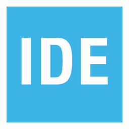
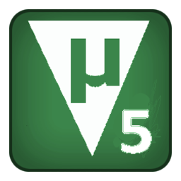
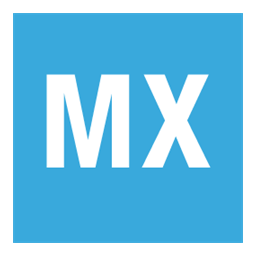
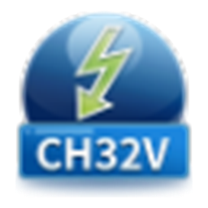
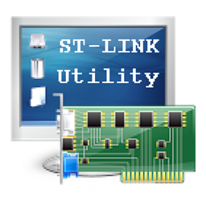
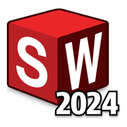
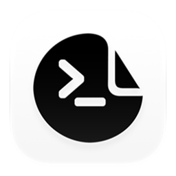

&nbsp;&nbsp;&nbsp;&nbsp;

&nbsp;&nbsp;&nbsp;&nbsp;

&nbsp;&nbsp;&nbsp;&nbsp;

欢迎来到我的 GitHub 主页。我是 <b>xing-crypto-code</b>，一名从英语专业转向电子信息工程的学生，正在努力成为电控全栈嵌入式硬件工程师。

Electronics enthusiast on the path from an English major to a full-stack embedded hardware engineer. Passionate about AIoT, embedded systems, and FPV racing drones — from firmware tuning to designing custom flight controller boards.

 

🚪 visitors

## My favorite tools and technologies ⚙️

> Tools and technologies that I have worked with and am interested in

<table>
  <tr>
    <td align="center" width="96">
        
       C++
    </td>
    <td align="center" width="96">
        
       Python
    </td>
    <td align="center" width="96">
        
       GitHub
    </td>
    <td align="center" width="96">
        
       Raspberry Pi
    </td>
    <td align="center" width="96">
        
       Arduino
    </td>
    <td align="center" width="96">
        
       C
    </td>
    <td align="center" width="96">
        
       CMake
    </td>
    <td align="center" width="96">
        
       Bash
    </td>
  </tr>
  <tr>
    <td align="center" width="96">
        
       Linux
    </td>
    <td align="center" width="96">
        
       STM32CubeIDE
    </td>
    <td align="center" width="96">
        
       Visual Studio
    </td>
    <td align="center" width="96">
        
       VS Code
    </td>
    <td align="center" width="96">
        
       MATLAB
    </td>
    <td align="center" width="96">
        
       Git
    </td>
    <td align="center" width="96">
        
       GitHub Desktop
    </td>
    <td align="center" width="96">
        
       DSH Desktop
    </td>
  </tr>
  <tr>
    <td align="center" width="96">
        
       Keil uVision
    </td>
    <td align="center" width="96">
        
       STM32CubeMX
    </td>
    <td align="center" width="96">
        
       WCH ISP
    </td>
    <td align="center" width="96">
        
       MounRiver
    </td>
    <td align="center" width="96">
        
       ST-LINK
    </td>
    <td align="center" width="96">
        
       JLC EDA
    </td>
    <td align="center" width="96">
        
       SolidWorks
    </td>
    <td align="center" width="96">
        
       Agents Anywhere
    </td>
  </tr>
  <tr>
    <td align="center" width="96">
        
       ESP32
    </td>
    <td align="center" width="96">
        
       STM32
    </td>
    <td align="center" width="96">
        
       KiCad
    </td>
    <td align="center" width="96">
        
       PlatformIO
    </td>
  </tr>
</table>

## Github stats 📊

  
GitHub Profile Stats 💻

   
    
    
   

  
Contribution Graph 📈

   

   

  
Profile Views 👁️

   
  

  
Work Time Distribution ⏳

   

<!--START_CONTRIBUTIONS:readme-info-->
<b>🏆 65 Contributions in year 2026</b>
<!--END_CONTRIBUTIONS:readme-info-->

 

<table>
<tr>
<td valign="top" width="50%">

<!--START_SECTION_DAILY_COMMIT:readme-info-->
<b>I'm an early 🐤</b> <table><tbody><tr><th align="left">时段</th><th align="right">提交</th><th align="left">占比</th></tr><tr><td align="left">🌞 Morning</td><td align="right">11</td><td align="left"><code>██░░░░░░░░░░░░</code> 12.4%</td></tr><tr><td align="left">🌆 Daytime</td><td align="right">41</td><td align="left"><code>██████░░░░░░░░</code> 46.1%</td></tr><tr><td align="left">🌃 Evening</td><td align="right">37</td><td align="left"><code>██████░░░░░░░░</code> 41.6%</td></tr><tr><td align="left">🌙 Night</td><td align="right">0</td><td align="left"><code>░░░░░░░░░░░░░░</code> 0.0%</td></tr></tbody></table>
<!--END_SECTION_DAILY_COMMIT:readme-info-->

</td>
<td valign="top" width="50%">

<!--START_SECTION_WEEKLY_COMMIT:readme-info-->
📅 <b>Most Productive on Saturdays</b> <table><tbody><tr><th align="left">星期</th><th align="right">提交</th><th align="left">占比</th></tr><tr><td align="left">Monday</td><td align="right">5</td><td align="left"><code>█░░░░░░░░░░░░░</code> 5.6%</td></tr><tr><td align="left">Tuesday</td><td align="right">17</td><td align="left"><code>███░░░░░░░░░░░</code> 19.1%</td></tr><tr><td align="left">Wednesday</td><td align="right">10</td><td align="left"><code>██░░░░░░░░░░░░</code> 11.2%</td></tr><tr><td align="left">Thursday</td><td align="right">4</td><td align="left"><code>█░░░░░░░░░░░░░</code> 4.5%</td></tr><tr><td align="left">Friday</td><td align="right">14</td><td align="left"><code>██░░░░░░░░░░░░</code> 15.7%</td></tr><tr><td align="left">Saturday</td><td align="right">28</td><td align="left"><code>████░░░░░░░░░░</code> 31.5%</td></tr><tr><td align="left">Sunday</td><td align="right">11</td><td align="left"><code>██░░░░░░░░░░░░</code> 12.4%</td></tr></tbody></table>
<!--END_SECTION_WEEKLY_COMMIT:readme-info-->

</td>
</tr>
</table>

  
Tech Focus 🎯

   

## Recent GitHub Activity ✅

  
What I'm working on 🔧

   

| 项目 | 说明 |
| :--- | :--- |
| 🛩️ **DIY Quadcopter** | 从零组装 · 固件调参 · 自研飞控板 |
| ⌨️ **9-Key Keyboard** | 立创 EDA 大赛参赛作品 |
| 🤖 **XiaoZhi AI Chatbot** | 语音交互 · 端侧推理 |
| 📚 **BabelCore** | 人机协作翻译平台 |

 

 

🌙 real-time moon phase · 实时月相

