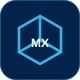
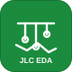

<!-- 打字机 -->

 

<!-- 🚪 访问计数 -->

 

🚪 visitors

<h2 align="center">🛠️ Tech Stack</h2>

<!-- ═══ 芯片平台 Chip Platforms ═══ -->
<b>芯片平台 · Chip Platforms</b>

 

&nbsp;

&nbsp;

&nbsp;

&nbsp;

&nbsp;

 
 

<!-- ═══ 开发环境 IDE & Toolchain ═══ -->
<b>开发环境 · IDE &amp; Toolchain</b>

 

&nbsp;

&nbsp;

&nbsp;

&nbsp;

&nbsp;

 
 

<!-- ═══ 语言 Languages ═══ -->
<b>语言 · Languages</b>

 

&nbsp;

&nbsp;

&nbsp;

&nbsp;

 
 

<!-- ═══ 硬件设计 Hardware Design ═══ -->
<b>硬件设计 · Hardware Design</b>

 

&nbsp;

&nbsp;

&nbsp;

&nbsp;

 
 

<!-- ═══ 协作与工具 Collaboration ═══ -->
<b>协作与工具 · Collaboration</b>

 

&nbsp;

&nbsp;

&nbsp;

&nbsp;

 
 

<!-- ═══ 技术方向 Focus ═══ -->

<h2 align="center">🐍 Contribution Graph</h2>

<!-- 贪吃蛇 -->

<h2 align="center">📊 GitHub Stats</h2>

<!-- ⭐ GitHub Readme Info（由 Action 自动填充） -->
<!--START_SECTION_PROFILE_VIEWS:readme-info-->
<!--END_SECTION_PROFILE_VIEWS:readme-info-->

<!--START_CONTRIBUTIONS:readme-info-->
**🏆 86 Contributions in year 2026**
<!--END_CONTRIBUTIONS:readme-info-->

 

<!-- 左右并排：作息分布 | 星期分布 -->
<table>
<tr>
<td valign="top" width="50%">

<!--START_SECTION_DAILY_COMMIT:readme-info-->
<b>I'm an early 🐤</b> <table><tbody><tr><th align="left">时段</th><th align="right">提交</th><th align="left">占比</th></tr><tr><td align="left">🌞 Morning</td><td align="right">11</td><td align="left"><code>██░░░░░░░░░░░░</code> 13.4%</td></tr><tr><td align="left">🌆 Daytime</td><td align="right">34</td><td align="left"><code>██████░░░░░░░░</code> 41.5%</td></tr><tr><td align="left">🌃 Evening</td><td align="right">37</td><td align="left"><code>██████░░░░░░░░</code> 45.1%</td></tr><tr><td align="left">🌙 Night</td><td align="right">0</td><td align="left"><code>░░░░░░░░░░░░░░</code> 0.0%</td></tr></tbody></table>
<!--END_SECTION_DAILY_COMMIT:readme-info-->

</td>
<td valign="top" width="50%">

<!--START_SECTION_WEEKLY_COMMIT:readme-info-->
📅 <b>Most Productive on Saturdays</b> <table><tbody><tr><th align="left">星期</th><th align="right">提交</th><th align="left">占比</th></tr><tr><td align="left">Monday</td><td align="right">5</td><td align="left"><code>█░░░░░░░░░░░░░</code> 6.1%</td></tr><tr><td align="left">Tuesday</td><td align="right">17</td><td align="left"><code>███░░░░░░░░░░░</code> 20.7%</td></tr><tr><td align="left">Wednesday</td><td align="right">10</td><td align="left"><code>██░░░░░░░░░░░░</code> 12.2%</td></tr><tr><td align="left">Thursday</td><td align="right">4</td><td align="left"><code>█░░░░░░░░░░░░░</code> 4.9%</td></tr><tr><td align="left">Friday</td><td align="right">14</td><td align="left"><code>██░░░░░░░░░░░░</code> 17.1%</td></tr><tr><td align="left">Saturday</td><td align="right">21</td><td align="left"><code>████░░░░░░░░░░</code> 25.6%</td></tr><tr><td align="left">Sunday</td><td align="right">11</td><td align="left"><code>██░░░░░░░░░░░░</code> 13.4%</td></tr></tbody></table>
<!--END_SECTION_WEEKLY_COMMIT:readme-info-->

</td>
</tr>
</table>

<!-- ═══════════════════════════════════════════════════════════
     页脚 · Footer
     ═══════════════════════════════════════════════════════════ -->

 

 

Built with passion and lots of coffee ☕

<!-- ═══════════════════════════════════════════════════════════
     🌙 实时月相 · 页面结尾
     ═══════════════════════════════════════════════════════════ -->

 

 

🌙 real-time moon phase · 实时月相

